 

  
  

**Software engineer building full-stack products, developer tools, and practical AI-powered workflows.**

*From a rough idea to working software—with curiosity, iteration, and a healthy obsession with how things work.*

---

## About

I'm a Computer Science graduate who enjoys building across the stack: designing interfaces, building APIs, working with data, and figuring out how to ship software that is useful beyond a demo.

My interests sit at the intersection of **full-stack engineering, AI applications, developer tooling, automation, and product design**. I like experimenting with new ideas, but I care just as much about debugging, integration, and the details that make a project work.

- **Building:** full-stack applications, AI-assisted tools, and automation workflows
- **Core stack:** Python, JavaScript/TypeScript, React, FastAPI, Flask, SQL
- **Also exploring:** Java/Spring Boot, Docker, CI/CD, agentic workflows, and system design
- **Approach:** understand the problem, build the smallest useful version, test it, improve it

---

## Selected projects

A few projects that represent the kinds of problems I like working on.

<table>
<tr>
<td width="50%" valign="top">

### [GitPix](https://github.com/cser-utkarsh-raj/GitPix)

A GitHub profile README designer focused on helping developers create polished profile pages, with reusable visual styles and generated README content.

Python · JavaScript · GitHub

</td>
<td width="50%" valign="top">

### [myMentor](https://github.com/cser-utkarsh-raj/myMentor)

An AI-powered learning companion designed to turn goals into structured roadmaps, daily study plans, progress tracking, and adaptive guidance.

React · FastAPI · AI · PDF workflows

</td>
</tr>
<tr>
<td width="50%" valign="top">

### [FarmHub](https://github.com/cser-utkarsh-raj/FarmHub)

An agricultural technology project exploring farmer-focused tools, with a React/TypeScript frontend and a Python backend for data-driven workflows.

React · TypeScript · FastAPI · SQLAlchemy

</td>
<td width="50%" valign="top">

### [The Bloom](https://github.com/cser-utkarsh-raj/The-Bloom)

A top-down, atmospheric survival-horror game set in a world shaped by a spreading biological infection. Focused on gameplay systems, exploration, and environmental tension.

JavaScript · Phaser 3 · Game development

</td>
</tr>
<tr>
<td width="50%" valign="top">

### [Sisyphus](https://github.com/cser-utkarsh-raj/Sisyphus)

An automation project for generating and publishing short-form video content across social platforms, with a pipeline-oriented approach to media processing.

TypeScript · Automation · Media pipelines

</td>
<td width="50%" valign="top">

### [goPanda](https://github.com/cser-utkarsh-raj/goPanda)

A productivity-focused application built around helping people organize focused work and everyday tasks.

React · TypeScript · Vite

</td>
</tr>
<tr>
<td width="50%" valign="top">

### [TerraVault](https://github.com/cser-utkarsh-raj/TerraVault)

An interactive web project built around exploring and presenting knowledge about Earth, natural phenomena, disasters, and mysteries.

Web development · Interactive UI

</td>
<td width="50%" valign="top">

### [StoreBook](https://github.com/cser-utkarsh-raj/StoreBook)

A backend-oriented e-commerce project exploring service-based architecture and the building blocks behind a maintainable application.

Java · Spring Boot · Microservices

</td>
</tr>
</table>

More experiments and repositories live in the [full project list →](https://github.com/cser-utkarsh-raj?tab=repositories).

---

## Tools I work with

**Languages**

**Frontend & Backend**

**Data, DevOps & Workflow**

---

## GitHub at a glance

 

---

## What I'm exploring

- **AI applications & agents** — useful workflows, tool integrations, and evaluation
- **Backend engineering** — API design, data modeling, security, and reliability
- **Software delivery** — Git workflows, automated testing, containers, and CI/CD
- **Product engineering** — turning ambitious ideas into understandable, usable software

---

## Let's build

I'm interested in collaborating on **developer tools, AI-powered products, automation, open-source software, and unusual side projects**.

If something here is useful, explore the repositories, open an issue, or reach out through [GitHub](https://github.com/cser-utkarsh-raj).

**small idea → working software → something useful**

Built with curiosity, iteration, and a bias toward shipping.

